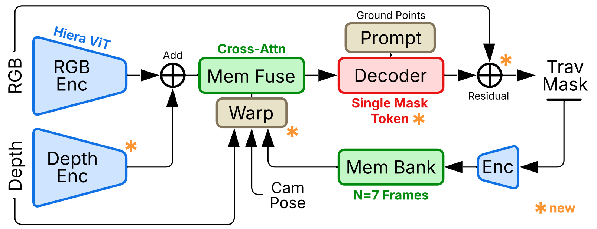

# SAM-VTP

Traversability prediction from a video stream. Output is continuous rather than
binary: each pixel gets a value in `[0,1]` meaning expected cost-free progress
for a given platform, so fresh asphalt and a 25 degree gravel slope don't
collapse to the same "drivable" label.

The model keeps a short memory across frames so the prediction stays stable while
the camera moves, and reads it with attention over content rather than over image
coordinates. It takes RGB and metric depth; it needs no pose, odometry or
localisation of any kind.

Two parts: **the model** (`src/sam_vtp_core/`), defined end to end in one file
depending only on PyTorch, and **the label pipeline**
(`src/sam_vtp_core/labels/`), which builds the continuous training target from
simulator depth and semantics.

## Install

```bash
# PyTorch first, for your CUDA build: https://pytorch.org/get-started/locally/
pip install -e .              # model + inference
pip install -e ".[labels]"    # also the label pipeline (adds OpenCV)
```

Python 3.8+, PyTorch 2.0+. No SAM 2, Hydra or OmegaConf dependency.

## Quick start

Frames must arrive in capture order, memory carries across them. A shuffled
folder won't error, it will just give you an incoherent result.

```python
import torch
from sam_vtp_core import build_model

model = build_model("sam_vtp.pt", device=torch.device("cuda"))

model.reset_memory()                     # between independent sequences
for t, (rgb, depth) in enumerate(stream):
    out = model.forward_frame(rgb,       # (1,3,H,W) RGB in [0,255]
                              is_init_frame=(t == 0),
                              depth=depth)   # (1,1,H,W) planar z-depth, METRES
    traversability = out["logits"].sigmoid()   # (1,1,H,W) in [0,1]
```

A whole clip at once:

```python
out = model(images, depth_sequence=depths)   # (B,T,...)
```

Command line:

```bash
sam-vtp-infer --images-dir frames/ --depth-dir depth/ \
              --checkpoint sam_vtp.pt --output-dir predictions/ \
              --height 512 --width 512
```

Writes `predictions/probability/*_prob.png` (continuous, 0-255) and
`predictions/binary/*_bin.png` (thresholded, default 0.5).
`sam-vtp-smoke --checkpoint sam_vtp.pt` runs a few synthetic frames and prints
what the checkpoint actually built — the quickest way to check a file is what you
think it is.

For a live camera, `SAMVTPStreamProcessor` does no camera I/O, just the loop:

```python
from sam_vtp_core import SAMVTPStreamProcessor

stream = SAMVTPStreamProcessor(model, resize_hw=(512, 512), threshold=0.5,
                               input_fit="pad", return_numpy=True)
while (frame := grab()) is not None:
    result = stream.step(frame.rgb, depth=frame.depth)
    if result.memory_fill_level < 1.0:
        continue                       # bank still filling
    plan(result.probabilities)         # (H, W) numpy array
```

See [`docs/integration.md`](docs/integration.md) for camera intrinsics,
aspect-ratio fitting and memory cadence.

## Component switches

Three parts can be switched off at runtime:

| Switch | Off means |
|---|---|
| `memory` | frame-wise; every frame predicted from scratch, bank never read or written |
| `geometry` | RGB-only; no depth-derived feature |
| `refine` | no residual refinement head |

```python
model = build_model("sam_vtp.pt", device=dev, components={"memory": False})
model.set_components(geometry=False)          # chainable, returns the model

with model.components(geometry=False):        # temporary, restored on exit
    rgb_only = model.forward_frame(rgb, is_init_frame=True)
```

`--no-memory`, `--no-geometry` and `--no-refine` do the same on the CLI.

A switch selects which of the checkpoint's weights are *used*; it cannot add a
component the checkpoint lacks, and `set_components` raises rather than running a randomly-initialised module. Turning one off is a deliberate ablation, not a neutral setting: the remaining weights were fitted alongside it and now run outside their training distribution. `describe(model)` appends an explicit `[ABLATED: ...]` clause whenever the active configuration differs from the as-trained one, so a log line distinguishes the two.

Switching components after a CUDA graph has been captured raises, the graph has
the old configuration baked into its control flow.

## Inputs that have to be right

Three conventions give you a plausible but wrong map if violated, and nothing
downstream can detect it. Worth checking once at integration time.

| Input | Requirement | If it's wrong |
|---|---|---|
| **Depth** | Planar z-depth along the optical axis, in **metres** | The geometry channels are metric. Millimetres are off by 1000x, normalised `[0,1]` depth is meaningless. |
| **Intrinsics** | Yours, at the resolution they were calibrated at | The default is the TartanGround simulator camera (640x640, 90 degree FOV). Wrong intrinsics tilt every slope and shift every correspondence. |

**No pose or odometry is required anywhere.** The geometry channels are a
function of depth and intrinsics alone, so the perception stack carries no
localisation dependency. A geometry checkpoint run without depth raises rather
than quietly falling back.

## How it works

<p align="center"></p>

RGB and depth are encoded and summed, the result is fused with the memory bank
by memory attention, and the decoder's output gets a residual correction from
full-resolution RGB before being written back into the bank. Starred blocks are
what SAM-VTP adds on top of SAM 2.

Per frame, in `architecture.py`:

1. **Image encoder** (Hiera-T + FPN) gives features at strides 4, 8 and 16.
2. **Geometry** (optional) derives log-depth, slope, roughness, height and
   validity from depth and adds them to the stride-16 level through a
   zero-initialised gate, so a geometry model starts out identical to one without.
3. **Memory attention** conditions those features on a 7-slot bank, each slot
   first resampled into the current camera frame.
4. **Mask decoder** produces logits under a fixed learned prompt.
5. **Refinement head** adds a residual conditioned on full-resolution RGB.
6. **Memory encoder** compresses (features, prediction) back into the bank.

| Component | Parameters |
|---|---:|
| Image encoder (Hiera-T + FPN) | 27.2 M |
| Memory attention | 5.9 M |
| Mask decoder | 4.2 M |
| Learned prompt | 2.1 M |
| Memory encoder | 1.4 M |
| Geometry encoder | 127.6 k |
| Refinement head | 905 |
| **Total** | **41.2 M** |

Two things differ from SAM 2 and are worth knowing before reading the code.

**The prompt is learned, not clicked.** SAM 2 is interactive; here there is no
user and the region of interest is always "ground this platform can drive on", so
the prompt is fixed and learned during training. Point coordinates passed to the
decoder are accepted and ignored. A checkpoint carrying SAM 2's
`point_embeddings` / `mask_downscaling` weights is a different model and won't
load.

**Memory is read without geometric alignment.** SAM 2 tags each memory slot with
a position encoding that is a pure function of grid index, giving memory
attention the prior "token *k* in memory is token *k* now". On a forward-driving
robot that is false every frame, since the field flows outward and rescales. An
earlier revision resampled stored features into the current camera frame using
depth and pose to supply the correspondence explicitly. It was removed: measured
at 1000 sequence windows it moved fuzzy Jaccard by +0.0016 (95% CI
[-0.0035, +0.0002], not significant, and smaller than twice the seed-to-seed
spread) while requiring a camera pose at inference. Attention recovers the
correspondence from content well enough that paying a localisation dependency for
it is not worth it.

Checkpoints load **strictly**, and the architecture is read back from the weights
rather than from flags — the geometry encoder and refinement head are top-level
modules, so a lenient load would drop all of their tensors silently
and run an ablated model under the full model's name.

## Label generation

The training target is generated, not hand-annotated:

```
y = semantic_prior(class) x slope_factor x roughness_factor x height_gate
```

```bash
sam-vtp-labels --root /data/tartanground --workers 24
```

See [`docs/labels.md`](docs/labels.md) for the taxonomy, the geometry, and the
four choices that shape the output most.

## Layout

```
src/sam_vtp_core/
  architecture.py   the entire network: SAM 2 blocks, geometry, SAM-VTP
  factory.py        checkpoint-driven construction (strict)
  inference.py      sequence inference, depth loading
  stream.py         camera-agnostic streaming loop
  fullgraph.py      optional CUDA-graph replay of the full forward pass
  cli.py, smoke.py  entry points
  labels/           taxonomy.py, generate.py
scripts/
  infer_sequence.py, smoke_test.py, verify_fullgraph_parity.py
```

`fullgraph.py` is a second implementation of the forward pass, written over
tensorised state so it can be captured as a CUDA graph. Since it duplicates the
forward pass, run `verify_fullgraph_parity.py` after touching `architecture.py`.

## Citation

```bibtex
[TBD]
```

## License

MIT, see `LICENSE`. Parts of `architecture.py` derive from SAM 2 (Apache 2.0),
see `NOTICE`.
