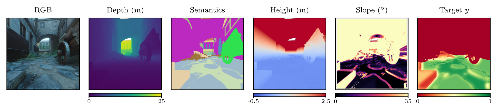

# Label generation

<p align="center"></p>

Training targets combine a semantic prior with terrain geometry for each frame:

```
y = semantic_prior(class) * slope_factor * roughness_factor * height_gate
```

The prior is defined per surface class and shared across environments, so a threshold means the same thing in every scene.

```bash
sam-vtp-labels --root /data/tartanground --workers 24
```

Input layout:

```
<root>/<Env>/seg_label_map.json
<root>/<Env>/Data_diff/<Pxxxx>/depth_lcam_front/000000_lcam_front_depth.png
<root>/<Env>/Data_diff/<Pxxxx>/seg_lcam_front/000000_lcam_front_seg.png
<root>/<Env>/Data_diff/<Pxxxx>/pose_lcam_front.txt       (optional)
<root>/<Env>/Data_diff/<Pxxxx>/<Pxxxx>_metadata.json     (optional)
```

Output is `<traj>/trav_lcam_front/{frame:06d}_lcam_front_trav.png`: 8-bit, where 255 is fully traversable.

## Parameters

Class scores are in `labels/taxonomy.py` and geometry constants in `labels/generate.py`. The values assume a platform with about 0.15 m wheel radius, 0.20 m clearance, a 30° stable slope and a 0.15 m negotiable step.

| Term | Definition |
|---|---|
| Slope factor | 1.0 below 12°, falling linearly to 0.30 at 35° |
| Roughness factor | 1.0 below 0.03 m local height deviation, falling linearly to 0.40 at 0.20 m |
| Local obstacle | Non-traversable above 0.55 m relative to local terrain |
| Absolute height | Non-traversable outside -1.0 m to 2.5 m |
| Vegetation bands | Ground cover below 0.25 m; obstruction above 0.60 m |

## Implementation notes

- **Camera height** is estimated once per trajectory. A per-frame ground median varies by about 0.5 m on vegetated terrain, which moves the height gate.
- **Slope** uses an 11 px stencil over median-filtered depth, so it measures terrain grade rather than individual leaves.
- **Modulation** is smoothed at sigma 12 and normalised by the traversable mask, which stops walls darkening adjacent ground. The prior is never smoothed, so class boundaries stay sharp.
- **Height and slope** are gravity-aligned using per-frame pose. One degree of uncorrected pitch gives about 0.87 m of height error at 50 m. Without a pose file, the generator warns and assumes a level camera.
